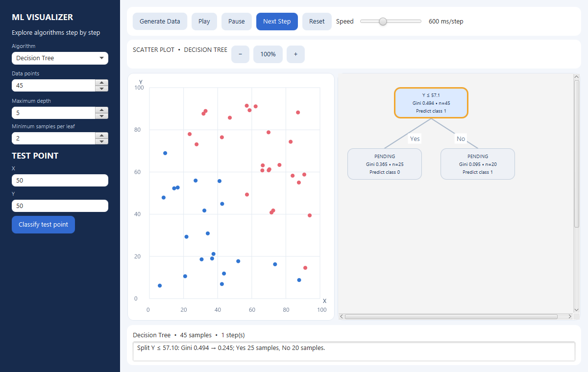
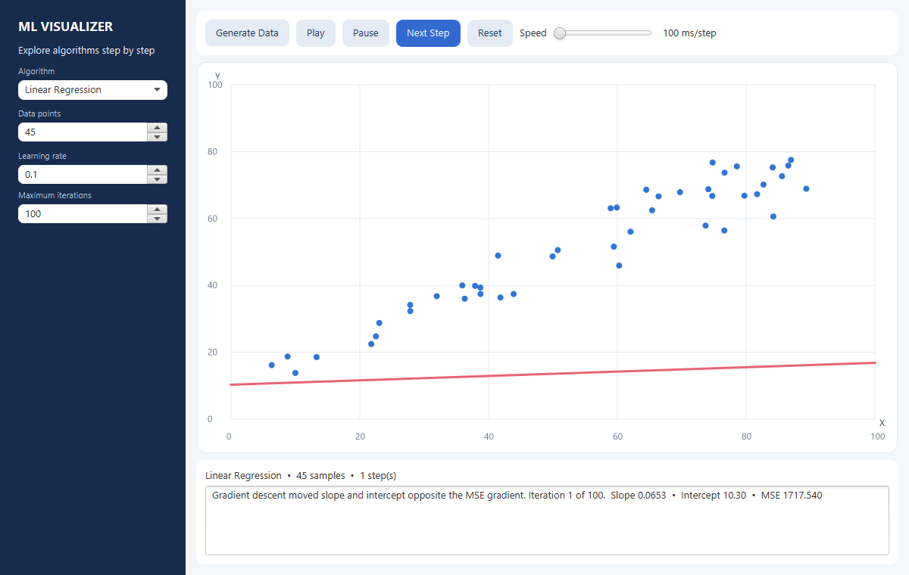
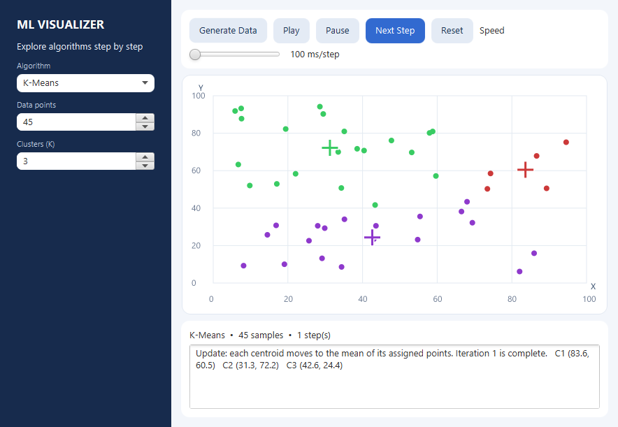
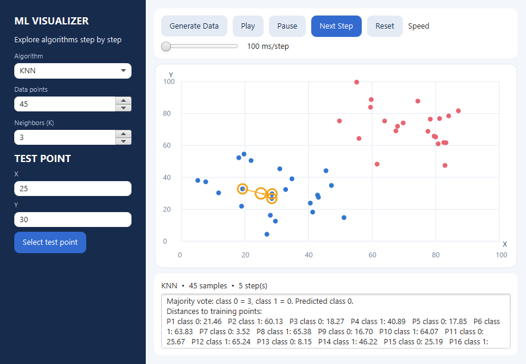

# ML Algorithm Visualizer - Project Report

**University Java OOP project**  
**Date:** 14 November 2026  
**Language target:** Java 17

## 1. Abstract

ML Algorithm Visualizer is a JavaFX desktop application that shows how four introductory machine learning algorithms change their state step by step. It visualizes K-Means clustering, a binary decision tree, simple linear regression, and K-nearest neighbors (KNN). The mathematical calculations are implemented in Java rather than delegated to an ML library. A shared abstract class makes the four models usable through the same controls. The application also demonstrates input validation and a background timing thread while keeping model changes on the JavaFX Application Thread.

## 2. Introduction

Machine learning results can be difficult to understand when an algorithm is presented as a single command. This project exposes intermediate states: point assignments and moving centroids, new tree nodes, a changing regression line, and a KNN vote. A user can move forward manually or let the program play automatically. The application uses synthetic two-dimensional data so each algorithm can be studied without data preparation.

## 3. Objectives

1. Implement four algorithms from their mathematical definitions.
2. Provide a clear visual step for each user action.
3. Demonstrate inheritance, polymorphism, encapsulation, arrays, `ArrayList`, exceptions, and multithreading.
4. Keep the interface responsive and prevent competing playback workers.
5. Validate parameters and show understandable error messages.
6. Keep the code small enough to explain in a university viva.

## 4. Technologies used

| Technology | Purpose |
|---|---|
| Java 17 source target | Classes, collections, algorithms, exceptions, threading |
| JavaFX 21.0.6 Controls | Buttons, spinners, slider, text area, sidebar |
| JavaFX Graphics and Canvas | Scatter plots, regression line, centroids, neighbors |
| JavaFX nodes and CSS | Decision tree cards, connections, colors, spacing |
| Maven | Compilation and JavaFX dependency resolution |
| Standard Java only | Algorithm math; no machine learning library |

The reviewed Maven dependency tree contains JavaFX Controls and Graphics as direct dependencies and JavaFX Base as a transitive dependency. No other runtime library is required by the project.

## 5. System design and architecture

`Main` builds the JavaFX scene, generates datasets, accepts parameter changes, and renders the current model. It stores the selected algorithm in an `MLAlgorithm` variable. The four subclasses own their mathematical state and each implement `nextStep()`, `reset()`, and `isComplete()`. `DataPoint` stores a sample's X/Y coordinates, binary class label, and cluster assignment. `TreeNode` stores one decision tree node. `AnimationWorker` is one daemon thread that waits between steps and submits step requests through `Platform.runLater`. Consequently, model changes and UI rendering occur on the JavaFX thread.

### Class hierarchy

```text
                    MLAlgorithm (abstract)
                  /       |        |       \
             KMeans  DecisionTree  LinearRegression  KNN
                         |
                      TreeNode

Main (Application) --> MLAlgorithm, DataPoint, AnimationWorker
InvalidParameterException --> IllegalArgumentException
```

This is inheritance for the four algorithm subclasses and composition for a decision tree's nodes. `Main` calls the subclass implementation through the parent reference, demonstrating runtime polymorphism.

## 6. Algorithms and mathematical formulas

### 6.1 K-Means clustering

`KMeans` stores K centroid coordinates in a `double[K][2]` array. Initially it chooses K distinct existing points. An assignment step gives each point to its nearest centroid using Euclidean distance:

`d(p,c) = sqrt((p.x - c.x)^2 + (p.y - c.y)^2)`

The next step replaces each nonempty cluster's centroid with the arithmetic mean of its members:

`c.x = sum(point.x) / count`, `c.y = sum(point.y) / count`.

An empty cluster keeps its previous centroid. Playback stops when centroid movement is below a small tolerance or after 100 completed iterations. **Reset** restores the initial centroids and unassigns the points.

### 6.2 Decision Tree classification

`DecisionTree` handles binary labels 0 and 1 with numeric X and Y features. For a node containing fraction `p` of class 1, impurity is:

`Gini = 1 - p^2 - (1-p)^2`.

For each feature, the algorithm sorts observed values and tests thresholds midway between distinct adjacent values. It compares the weighted impurity of the two children:

`weighted Gini = (nYes * GiniYes + nNo * GiniNo) / nParent`.

Each click expands one pending node using the best improving valid split. The recursive pending-node search constructs the tree over multiple steps. Splitting stops at the selected maximum depth (1-15, default 5), for a pure node, when fewer than two minimum-size leaves can be made, or when no threshold improves Gini. A 127-node cap limits drawing work. A completed tree predicts a test point by following the Yes (`<= threshold`) or No branch until a leaf.

### 6.3 Linear Regression

`LinearRegression` fits `y = m*x + b` by batch gradient descent. Training scales X and Y to approximately 0-1 by dividing each coordinate by 100. This reduces the chance of oversized gradient updates. For normalized prediction `yHat = m*x + b` and error `e = yHat - y`, the gradients are:

`gradient_m = (2/n) * sum(e*x)`, `gradient_b = (2/n) * sum(e)`.

One step applies `m = m - learningRate*gradient_m` and `b = b - learningRate*gradient_b`. The GUI reports the intercept in original graph units and displays mean squared error `MSE = sum((prediction - actual)^2)/n`. The user can set the learning rate and maximum iterations.

### 6.4 K-Nearest Neighbors

`KNN` uses the same Euclidean distance formula as K-Means to compare a selected test point with each training point. The first step computes distances. The next K steps reveal the sorted nearest neighbors. The final step counts their binary labels and predicts the majority class. Equal distances are ordered by original point index; an equal class vote predicts class 0. Selecting a different test point clears the previous result.

## 7. Java OOP concepts in the implementation

| Concept | Concrete example |
|---|---|
| Classes and encapsulation | `DataPoint` and `TreeNode` hold private state with getters. |
| Inheritance | `KMeans`, `DecisionTree`, `LinearRegression`, and `KNN` extend `MLAlgorithm`. |
| Polymorphism | `Main` calls `algorithm.nextStep()` through the abstract parent reference. |
| Abstraction | `MLAlgorithm` defines the methods every visualized algorithm supplies. |
| Arrays | `double[][]` centroids in K-Means; `double[]` distances in KNN. |
| ArrayList | Datasets, tree samples, and sorted KNN neighbor indices. |
| Exceptions | `InvalidParameterException` and JavaFX alert handling for bad inputs. |
| Multithreading | `AnimationWorker` waits on a daemon thread; `Platform.runLater` performs each step on the UI thread. |

## 8. GUI and visualization

The dashboard has a sidebar for the selected algorithm's parameters, a central visualization area, a toolbar, and a bottom explanation panel. JavaFX Canvas draws graph axes, class colors, cluster points, centroids, the regression line, and highlighted KNN neighbors. JavaFX nodes and connecting lines draw the tree. The tree view supports zoom and panning. A short JavaFX transition interpolates centroid positions or regression-line parameters after a step. The speed slider controls the time between automatic steps. The toolbar wraps when the window becomes narrower.

## 9. Testing and results

Tests were run on 14 November 2026. Maven 3.9.11 built the project successfully with `mvn clean package` using Java 17 source compatibility. The `mvn javafx:run` launch succeeded. The Maven dependency tree resolved only JavaFX Controls, Graphics, and their Base dependency.

| Check | Observed result |
|---|---|
| K-Means nearest-centroid assignment and centroid means | Passed on a four-point known dataset. |
| Decision Tree Gini, depth-1 split, reset, and predictions | Root Gini was 0.5; both known points received the expected class. |
| Regression gradient descent | MSE fell from 2351.67 to 20.72 over 100 steps on `y = 10 + 0.7x` samples. |
| KNN distances, classes, tie | Euclidean distance matched `sqrt(50)` for the first example; both class predictions passed; a tie predicted class 0. |
| Invalid inputs | Invalid K, depth, learning rate, nonfinite point, and missing KNN test point raised the expected exception. |
| JavaFX controls | Programmatic scene tests exercised Play, Pause, one Next Step, Reset, switching all four algorithms, selecting a KNN point, zoom values, pan scroll values, and resize. Passed. |
| Parameters and safe switching | Depth, minimum leaf size, both K controls, learning rate, iteration limit, and data count were changed through JavaFX controls. Switching algorithms while playback was active stopped further steps. Passed. |
| Worker responsiveness | A JavaFX event ran while the timing worker was active; pause held the step count and restart advanced it. Passed. |

`tests/AlgorithmReview.java` contains repeatable mathematical checks without a test framework. The GUI smoke check used a temporary JavaFX harness and captured the actual scenes below. Physical mouse dragging was not independently verified by that harness.

## 10. Screenshots from the running application

These PNG files are direct snapshots of the JavaFX scene during the GUI smoke test. Each uses a newly generated random dataset; their point coordinates will vary between runs.

**Decision Tree after the first split**  


**Linear Regression after one gradient step**  


**K-Means after assignment and centroid update**  


**KNN after selecting a test point and voting**  


## 11. Challenges and solutions

- **Keeping the UI responsive:** the timing loop runs in `AnimationWorker`; the model and JavaFX nodes are updated only by a `Platform.runLater` callback. A latch prevents a backlog of queued steps.
- **Stopping safely:** the one worker pauses before model replacement, reset, or a manual step. The button's single-step action advances once after pausing.
- **Stable regression:** scaling both graph coordinates to 0-1 keeps the gradient updates moderate.
- **Readable large trees:** node positions are computed recursively, with zoom, scroll, and a 127-node cap.
- **Small-window layout:** a final scene check exposed clipped toolbar labels; changing the toolbar to wrap fixed the observed layout.

## 12. Known limitations

Data is synthetic and held only in memory. There is no import/export, persisted model, accuracy evaluation, or general multiclass support. The canvas is a fixed 0-100 feature plane. The tree's node cap and K-Means' iteration cap deliberately limit work. The included automated GUI smoke check confirms control behavior and resize measurements; freehand mouse drag behavior was not manually verified.

## 13. Conclusion

The project demonstrates four manually implemented ML algorithms through visible intermediate states. Its abstract algorithm parent, specialized subclasses, data structures, validation exception, and timing worker meet the intended OOP learning goals while keeping the application suitable for a Java university project.

## 14. Future scope

Possible extensions are CSV import, model metrics, saved sessions, multiclass labels, additional algorithms, and more extensive automated UI interaction tests. These are outside the current submitted implementation.

## Appendix A - Reproducing the checks

From the submitted folder, run `mvn clean package` and `mvn javafx:run`. The first command compiles the Java 17 source and packages the CSS resource. The second launches the dashboard. The algorithm checks can be run without JUnit or other test dependencies:

```powershell
javac --release 17 -cp target/classes -d target/test-classes tests/AlgorithmReview.java
java -cp 'target/classes;target/test-classes' AlgorithmReview
```

The deterministic classification examples use two class-0 points at (10,10) and (20,20), and two class-1 points at (80,80) and (90,90). With a maximum tree depth of 1 and a minimum leaf size of 2, the root splits into two pure leaves and predicts the expected classes for (15,15) and (85,85). The KNN test uses the same samples: its first distance from (15,15) to (10,10) is `sqrt(50)`, and a four-neighbor vote is tied 2-2, so class 0 wins by the documented rule.

The regression example uses nine points on `y = 10 + 0.7x`, with X from 10 to 90 in steps of 10. The measured MSE falls from 2351.67 to 20.72 after 100 steps at learning rate 0.1. The test checks reduction rather than an exact final slope because the model is intentionally stopped after a finite number of iterations.

K-Means chooses its initial centroids randomly from distinct data points, so the test does not assert a fixed cluster number. It checks that every assignment chooses the closest current centroid, then verifies that each updated centroid equals the mean of its assigned points. This validates the mathematics while respecting random initialization.
