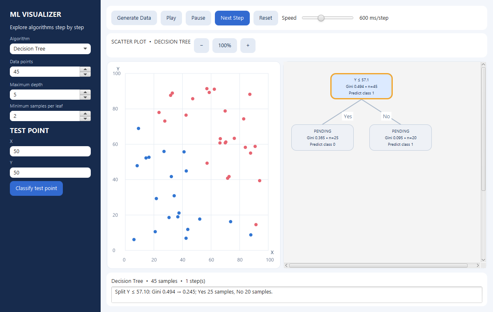

# ML Algorithm Visualiser

I made this as my final OOP project after finishing my university OOP course and studying these algorithms in my ML course. In class, I could follow the formulas on paper, but I wanted to see what actually changes at each step. So I built a small desktop app where I can pause an algorithm, move it forward once, and watch the result on a graph.

The math is written by hand in Java from what I learned in the ML course. There is no machine learning library doing the clustering, splitting, fitting, or voting for me. JavaFX handles the interface; the algorithms live in their own classes.



## What the app shows

| Algorithm | What you can watch |
|---|---|
| K-Means | Points join the nearest centroid, then the centroids move to the mean of each cluster. |
| Decision Tree | One node expands at a time. The tree shows the split condition, Gini impurity, sample count, and predicted class. |
| Linear Regression | The line changes after each gradient descent update. The current slope, intercept, and MSE are shown below the graph. |
| K-Nearest Neighbors (KNN) | Distances are calculated, the nearest points are highlighted, and their votes produce a class prediction. |

**Next Step** does one step. **Play** runs steps automatically, **Pause** holds the current state, and **Reset** starts the selected algorithm again on the same data. The speed slider changes the delay between steps. For the tree and KNN, I can click the graph to choose a test point. The tree view also has zoom and pan controls.

The app generates its own 2D data so it is quick to try each algorithm. The points are different on each run.

## Running it

You need a JDK **17 or newer**, **Maven**, and a desktop environment that can open a JavaFX window. From the folder with `pom.xml`, run:

```bash
mvn clean package
mvn javafx:run
```

Maven downloads JavaFX the first time. The project uses JavaFX **21.0.6** (Controls and Graphics); it does not need a database or an ML dependency.

To run the small mathematical checks after building:

```bash
javac --release 17 -cp target/classes -d target/test-classes tests/AlgorithmReview.java
java -cp 'target/classes;target/test-classes' AlgorithmReview
```

The last command is written for Windows PowerShell. On macOS or Linux, replace the `;` in the classpath with `:`.

## Where the OOP work is

I used one abstract parent class, `MLAlgorithm`, for the operations every algorithm needs: `nextStep()`, `reset()`, and `isComplete()`. `KMeans`, `DecisionTree`, `LinearRegression`, and `KNN` extend it. The JavaFX class `Main` keeps an `MLAlgorithm` reference, so the same **Next Step** button calls different code depending on the algorithm selected. That is the main inheritance and runtime polymorphism example in this project.

`DataPoint` and `TreeNode` keep their fields private. I used `ArrayList<DataPoint>` for datasets and tree samples because their sizes change, and arrays where the shape is fixed: `double[][]` for K-Means centroids and `double[]` for KNN distances. `InvalidParameterException` covers bad inputs and the GUI shows a readable alert. `AnimationWorker` is one background thread for playback timing; it hands each model and UI update back to the JavaFX Application Thread.

The main files are:

```text
mlvisualizer/
  Main.java                       JavaFX window and graphs
  MLAlgorithm.java                abstract parent class
  KMeans.java                     clustering steps
  DecisionTree.java, TreeNode.java  Gini splits and tree nodes
  LinearRegression.java           gradient descent
  KNN.java                        distance ranking and voting
  DataPoint.java                  sample data
  AnimationWorker.java            playback timing thread
  InvalidParameterException.java  input errors
src/main/resources/mlvisualizer/style.css  interface styling
tests/AlgorithmReview.java       plain Java checks
```

There is more detail, formulas, test results, and actual app screenshots in [the project report](PROJECT_REPORT.md). A [PDF copy](output/pdf/ML_Algorithm_Visualizer_Project_Report.pdf) is also included.

## Things I kept simple

This is a learning project, so it uses generated data in memory rather than file imports or a database. The graph has two numeric features on a 0-100 scale, and classification is binary. The tree is capped at 127 nodes and depth 15; K-Means stops after convergence or 100 iterations. KNN classifies one test point at a time, with a tied vote going to class 0.

I tested the algorithms with small known datasets and checked the JavaFX controls with a programmatic scene test. The app's screenshots are from that run. I have not separately tested freehand mouse dragging for tree panning.
